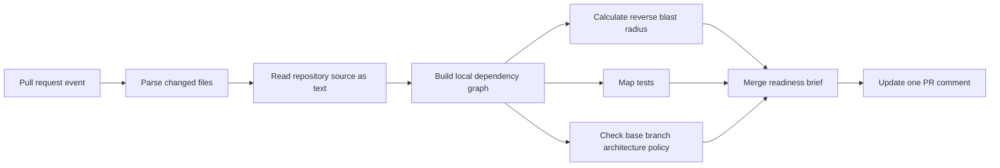

# CodeScope

**Website:** [shivamshinde123.github.io/CodeScope](https://shivamshinde123.github.io/CodeScope/)

CodeScope is a GitHub Action that gives pull-request reviewers an evidence-backed merge-readiness brief. It analyzes repository text and Git history without importing or executing pull-request code.

Version 2 focuses on four reviewer decisions:

- **Blast radius:** Which production files depend on the changed code?
- **Test evidence:** Which tests map to each changed production file?
- **Architecture drift:** Did the pull request add a forbidden dependency or a dependency cycle?
- **Merge readiness:** What deserves human attention before approval?

The result is one stable pull-request comment with a compact text summary and an optional Mermaid impact diagram. CodeScope is advisory: a clean result does not prove that a change is safe.

## Reviewer output

```text
CodeScope merge readiness
Missing required evidence

Blast radius
- src/service.py depends on changed src/core.py

Test evidence
- src/core.py: no mapped test

Architecture rules
- src/ui.py now imports src/data.py, violating layers

Recommended actions
- Add or map a test for src/core.py
- Replace the forbidden dependency or document an approved exception
```

When dependency paths exist, CodeScope also includes a collapsed Mermaid diagram. The text tables remain the accessible source of evidence; the diagram never carries meaning by color alone.

## Supported analysis

CodeScope v2 extracts repository-local imports from:

- Python files
- JavaScript files
- TypeScript files
- JSX and TSX files

The analysis is intentionally bounded:

- Files larger than 1 MB are skipped.
- At most 5,000 supported source files are scanned.
- Blast-radius traversal defaults to two dependency hops and can be configured up to five.
- Deleted source files cause an explicit incomplete-analysis result because they are absent from the head checkout.
- Unsupported languages remain visible in the pull-request change totals but do not contribute dependency edges.

## Quick start

Create `.github/workflows/codescope.yml` in the repository that CodeScope should analyze:

```yaml
name: CodeScope merge readiness

on:
  pull_request:
    types: [opened, synchronize, reopened]

permissions:
  contents: read
  pull-requests: write

jobs:
  codescope:
    runs-on: ubuntu-latest
    steps:
      - uses: actions/checkout@v4
        with:
          fetch-depth: 0
          persist-credentials: false

      - uses: shivamshinde123/CodeScope@master
```

The full checkout history is required so CodeScope can compare new dependency edges with the pull request base revision. `persist-credentials: false` prevents the checkout from leaving the GitHub token in local Git configuration.

No external AI API key is required. All v2 findings are deterministic.

### Fork pull requests

GitHub gives workflows from public forks a read-only token and withholds repository secrets. CodeScope can analyze those checkouts, but it may be unable to create or update the pull-request comment. Do not switch to `pull_request_target` and execute or install code from an untrusted pull request. Repositories that accept fork contributions should choose a separately reviewed publishing workflow or use the workflow log until a safer first-class publishing option is added.

## Repository policy

Architecture rules and optional test mappings live in `.codescope.toml` on the pull request base branch. Reading policy from the base branch prevents a pull request from weakening its own review rules.

```toml
[analysis]
max_depth = 2
ignore = ["generated/**", "vendor/**"]

[architecture]
forbid_cycles = true

[[architecture.forbid]]
id = "ui-data-boundary"
from = "src/ui/**"
to = "src/data/**"
reason = "UI code must access data through the service layer."

[[architecture.exceptions]]
rule = "ui-data-boundary"
from = "src/ui/legacy.py"
to = "src/data/legacy.py"
reason = "Temporary migration exception tracked by issue 123."

[[tests.map]]
source = "src/payments/**"
tests = ["tests/payments/**", "tests/integration/payment_*.py"]
```

### Policy fields

| Field | Meaning |
|---|---|
| `analysis.max_depth` | Maximum reverse-dependency hops shown in blast radius, from 1 to 5 |
| `analysis.ignore` | Repository-relative glob patterns excluded from source discovery |
| `architecture.forbid_cycles` | Reports a new dependency edge that closes a cycle |
| `architecture.forbid` | Explicit source-to-target dependency rules |
| `architecture.exceptions` | Narrow, documented exemptions from a rule or cycle check |
| `tests.map` | Optional source and test globs that supplement import-based test discovery |

Invalid policy never silently passes. CodeScope marks the analysis incomplete and explains the configuration error.

## Merge-readiness states

| State | Meaning |
|---|---|
| `Ready for review` | No high-confidence action was found; this is not a safety guarantee |
| `Needs targeted review` | Indirectly affected production code deserves reviewer attention |
| `Missing required evidence` | A changed production file lacks mapped tests or a new architecture violation exists |
| `Analysis incomplete` | CodeScope could not inspect enough evidence to make the other states useful |

CodeScope does not emit an opaque numerical risk score. Every action links back to a dependency path, test mapping, architecture rule, or explicit analysis limit.

## How it works



The analyzer does not run project builds, package installation, test commands, or imported repository modules. It installs and runs only CodeScope's own locked Python dependencies in the action directory.

## Local development

Requirements:

- Python 3.12 or later
- [uv](https://docs.astral.sh/uv/)

```bash
uv sync
uv run pytest -q
```

Project-specific product, architecture, configuration, and release decisions are maintained in [`docs/`](docs/).

## Data and privacy

CodeScope v2 reads the checked-out repository, pull-request diff metadata, and the base revision inside the GitHub-hosted runner. It sends requests to the GitHub API to fetch the diff and create or update its comment. It does not send source code or repository metadata to an AI provider, does not use analytics or advertising, and does not operate a separate CodeScope backend.

GitHub retains workflow logs and pull-request comments under the repository owner's GitHub settings and agreement. CodeScope itself creates no account and stores no additional user data. Repository owners remain responsible for reviewing their GitHub configuration, installed action versions, and dependency policies.

## Security

- Use the minimum workflow permissions shown above.
- Keep the policy file on the base branch authoritative.
- Do not use privileged workflow events to execute untrusted pull-request code.
- Pin CodeScope and other third-party actions to a reviewed commit SHA for higher-assurance environments.
- Treat the generated report as review assistance, not proof of correctness or security.

Report security concerns through the repository's GitHub issue tracker without including secrets or private source code. A dedicated private security contact is TBD.

## Limitations

- Import extraction does not resolve every framework alias, runtime import, reflection mechanism, generated dependency, or cross-repository call.
- Test mapping identifies evidence; it does not determine whether assertions are sufficient.
- Architecture rules are useful only when maintainers define accurate boundaries.
- Large monorepositories may require future incremental indexing.
- Cross-repository blast radius and organization-wide policies are outside the v2 MVP.

## License

CodeScope is released under the [MIT License](LICENSE). Third-party dependencies retain their own licenses.

This software is provided as-is, without warranty. Findings are advisory and may be incomplete or incorrect.
