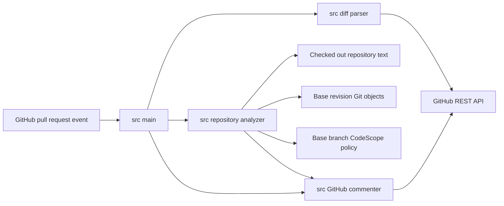

# Component Map

## Responsibilities

| Component | Responsibility | Must not do |
|---|---|---|
| `action.yml` | Install CodeScope dependencies and pass trusted GitHub context | Execute repository build or test commands |
| `src/main.py` | Orchestrate one analysis run | Contain dependency-analysis rules |
| `src/diff_parser.py` | Fetch and normalize changed-file metadata | Infer architecture or risk |
| `src/repository_analyzer.py` | Build graph, calculate impact, map tests, enforce policy, render deterministic Mermaid | Publish GitHub comments or call AI services |
| `src/github_commenter.py` | Format and publish one stable reviewer brief | Decide which findings exist |
| `.codescope.toml` | Declare repository-owned policy | Override policy from the pull-request head |
| `tests/` | Verify deterministic behavior and API boundaries | Require live GitHub credentials |

## Ownership

The repository owner is `shivamshinde123`. Additional maintainer and security-contact ownership is TBD.
