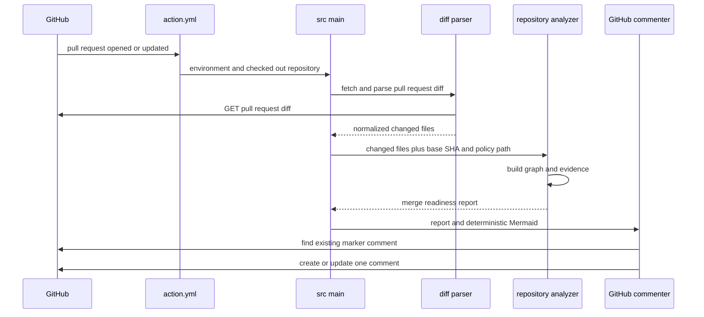

# Code Flow

## Entry point

## State flow

1. `get_env_vars` validates required GitHub context.
2. `fetch_pr_diff` requests the unified diff with a 30-second timeout.
3. `parse_diff` converts the diff to file records; `build_change_summary` applies PR-size limits.
4. `load_policy` reads `.codescope.toml` from the base Git object, not from the head working tree.
5. `discover_source_files` scans supported, bounded, non-symlink files.
6. `build_dependency_graph` extracts local imports without executing inspected code.
7. Reverse traversal calculates dependent impact paths.
8. Import evidence and optional policy maps connect changed production files to tests.
9. Head edges from changed sources are compared with base edges. New forbidden edges and configured new cycles become findings.
10. Analysis limits determine whether the result is incomplete. Otherwise findings select the advisory state.
11. `format_comment` produces text evidence first and a collapsed Mermaid diagram second.
12. The commenter locates either the v2 or legacy marker and updates in place.

## Failure flow

GitHub API, invalid environment, and unexpected analysis failures exit nonzero and appear in workflow logs. A missing or invalid base policy does not silently pass; invalid policy marks the report incomplete. Comment permission failures are not hidden.
