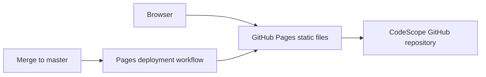
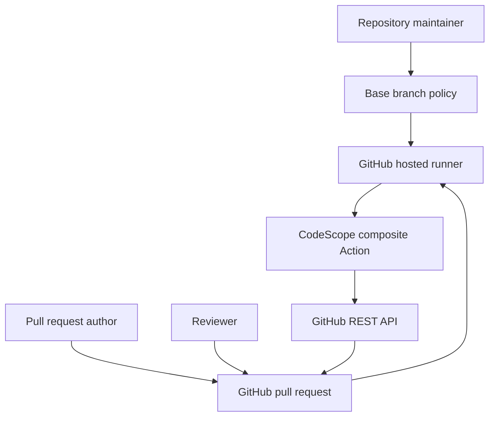

# System Architecture Document

## Public website boundary

The GitHub Pages site is a separate static presentation surface. It links to repository documentation and installation instructions but does not invoke the Action, inspect repositories, accept user input, or store data.

## Context

CodeScope has no hosted backend. The GitHub runner is the execution and data-processing boundary. GitHub remains the system of record for source, history, workflow logs, and the published comment.

## Trust boundaries

- Pull-request code and configuration are untrusted.
- Base-branch `.codescope.toml` is the trusted policy source.
- `GITHUB_TOKEN` is sensitive and must remain scoped to repository content read and pull-request comment write.
- GitHub API responses and Git output require validation and limits.
- CodeScope dependencies are trusted only to the degree established by pinned versions and dependency review.

## Security properties

- Static reads only for inspected repository content.
- No target-repository import, build, package installation, or test execution.
- No external AI or telemetry transmission in v2.
- Repository-relative configuration path validation.
- Symlink source files are skipped.
- Network calls use explicit timeouts.
- Findings remain advisory.

## Scaling

V2 scans the checkout on each run. Bounded discovery and traversal protect ordinary repositories. Incremental indexes, persistent graph storage, cross-repository edges, and organization-level policy would require a future service architecture and a new privacy and security review.

## Availability

If GitHub API access fails, the Action fails visibly. If analysis is partial, the comment reports `Analysis incomplete`. There is no separate CodeScope service whose availability can block the deterministic engine.
