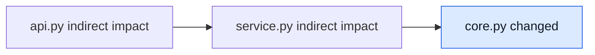

# UI and UX Wireframes

## Public website flow

```text
Navigation
  ↓
Reviewer problem + realistic CodeScope brief
  ↓
What else could break? / Is a test linked? / Did code break a team rule?
  ↓
Four short steps and an interactive example of linked files
  ↓
Installation snippet
  ↓
Trust model + GitHub call to action
```

The installation section is a three-step operational guide: add the workflow, optionally define base-branch policy, and interpret the pull-request state. Workflow and policy examples have independent copy controls, while every instruction remains visible without JavaScript.

The site uses a warm editorial "review desk" look with paper, ink, note colors, and hard borders. The interactive dependency diagram uses plain labels and explains each file link in text. All controls support keyboard focus. All key content works without JavaScript. The site removes motion when the visitor requests reduced motion.

## Pull request comment

```text
┌──────────────────────────────────────────────────────────────┐
│ CodeScope merge readiness                                    │
│ Missing required evidence                                    │
│                                                              │
│ 8 files changed · +140 / -32 lines                           │
│                                                              │
│ Blast radius                                                 │
│ Impacted component      Evidence path                        │
│ service.py              service.py -> core.py                │
│                                                              │
│ Test evidence                                                │
│ core.py                 missing     No mapped test            │
│                                                              │
│ Architecture rules                                           │
│ layers                  ui.py imports data.py                 │
│                                                              │
│ Recommended actions                                          │
│ [ ] Add or map a test for core.py                            │
│ [ ] Replace or approve the forbidden dependency              │
│ [ ] Review indirect dependents                               │
│                                                              │
│ ▸ Impact diagram                                             │
│ ▸ Analysis details                                           │
└──────────────────────────────────────────────────────────────┘
```

## Information order

1. Merge-readiness state.
2. Change size and explicit analysis limits.
3. Blast-radius evidence.
4. Test evidence.
5. Architecture findings.
6. Concrete actions.
7. Optional diagram and implementation details.

This order supports a quick scan while preserving deeper evidence for reviewers who need it.

## Diagram behavior



Labels identify files and arrows identify dependency direction. Blue is redundant emphasis for directly changed nodes; text carries the meaning. The diagram is collapsed by default to reduce comment height.

## States

- **Ready for review:** no high-confidence action, with a warning that this is not proof of safety.
- **Needs targeted review:** show indirect production impact prominently.
- **Missing required evidence:** list test and architecture actions before the diagram.
- **Analysis incomplete:** show the exact limit before any findings.

## Error communication

GitHub permission failures and unexpected runtime errors appear in the workflow log because CodeScope may not have permission to publish a comment. Invalid policy appears in the comment as incomplete analysis when publication remains possible.

## Accessibility

The text report is complete without Mermaid. Tables use descriptive headings, links and paths are readable text, and colors never carry the only distinction. Keyboard navigation, zoom, focus, and screen-reader behavior are provided by GitHub and should be verified on a real pull request before release.
